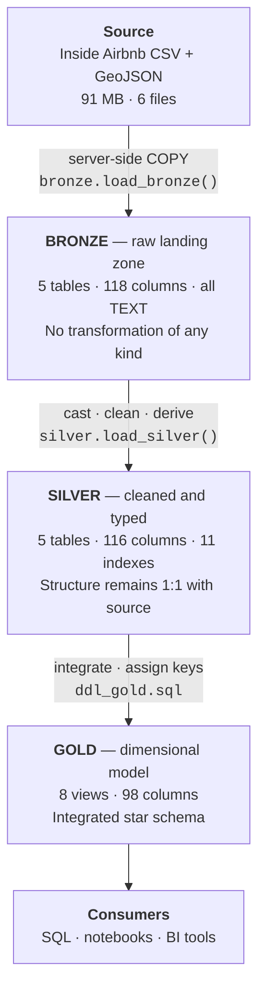
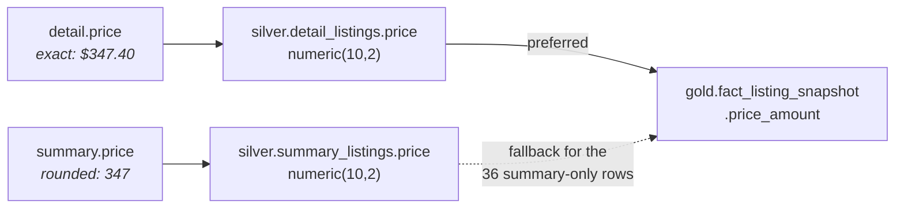
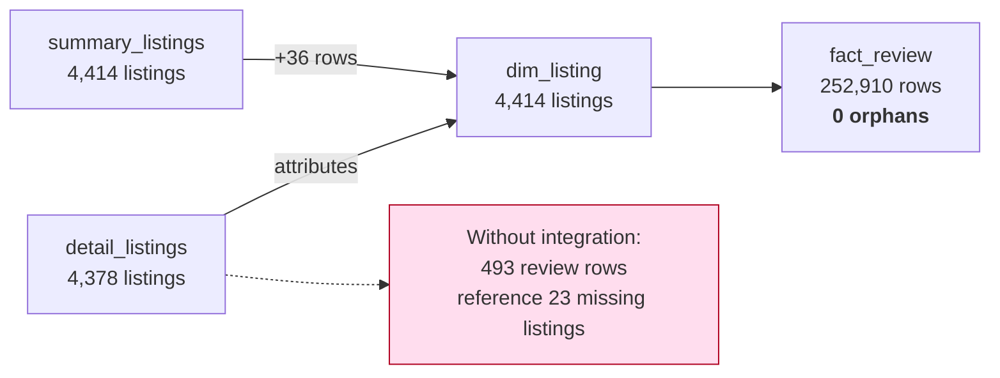

# Data Architecture

Technical specification of the warehouse: layer contracts, lineage, load strategy, physical design
and the reasoning behind the technology selection.

For the dimensional design specifically, see [data_model.md](data_model.md). For column-level
reference, see [data_catalog.md](data_catalog.md).

---

## 1. Architectural style

The warehouse implements the **medallion architecture**, in which data passes through three layers of
increasing refinement. Each layer has a single, narrow responsibility, and no layer performs work
belonging to another.



The value of the separation is diagnostic. When a number looks wrong, the layer boundaries localise
the fault: if Bronze matches the source files, ingestion is sound; if Silver row counts match Bronze,
no records were lost in cleaning; if Gold cardinality matches Silver, integration behaved. Each
boundary is asserted by the test suites.

---

## 2. Layer specifications

### 2.1 Bronze — raw landing zone

**Contract:** Bronze is a byte-faithful copy of the source drop. It must be possible to reconstruct
the analytical content of the source files from Bronze alone.

| Property | Specification |
|---|---|
| Materialisation | Base tables |
| Column types | `TEXT`, without exception |
| Transformation | None |
| Load pattern | `TRUNCATE` then `COPY` |
| Constraints | None — not even `NOT NULL` |

**Why every column is `TEXT`.** A typed landing zone can fail mid-load on a single malformed value,
leaving the layer in an indeterminate state and blocking ingestion of the remaining 99.9% of records.
Typing in Bronze also destroys evidence: `$347.40` becomes `347.40`, and the fact that the source
encoded currency as text is lost. Because Bronze is untyped, ingestion is effectively guaranteed to
succeed, and every defect remains visible for the Silver layer to address deliberately.

**Why `COPY` must use `FORMAT csv`.** Several source columns contain embedded newline characters —
`listings_detailed.host_about` in 898 records, `listings_summary.name` in 8. Line-oriented parsing
inflates `listings_detailed.csv` from 4,378 records to 7,782 apparent lines, a 78% overcount.
RFC 4180 quoted-CSV parsing is therefore mandatory; `FORMAT text` would shear records apart.

**GeoJSON handling.** `neighbourhoods.geojson` is stored as a single unmodified `jsonb` document in
`bronze.geo_neighbourhoods_raw`, read via `pg_read_file()`. `COPY` is unsuitable because the
document's internal commas and quoting would be misinterpreted. Parsing into geometry is deferred to
Silver, keeping Bronze free of transformation.

### 2.2 Silver — cleaned and typed

**Contract:** Silver contains the same information as Bronze, correctly typed, with defects resolved
and derivations added. Table structure remains 1:1 with the source systems.

| Property | Specification |
|---|---|
| Materialisation | Base tables |
| Column types | Native PostgreSQL types, including `geometry` |
| Transformation | Type casting, standardisation, defect resolution, derived columns |
| Load pattern | `TRUNCATE` then `INSERT … SELECT` from Bronze |
| Constraints | Primary keys; indexes supporting Gold joins |
| Audit | Every table carries `dwh_create_date timestamptz DEFAULT now()` |

**Why structure mirrors the source rather than integrating here.** Integration is deferred to Gold so
that each Silver table remains attributable to exactly one source file. When the two exports disagree
— as they do on price, in 2,300 of 3,693 comparable records — both values remain independently
inspectable in Silver, and the precedence rule is applied once, visibly, in Gold. Integrating in
Silver would discard the losing value and make the decision irrecoverable.

**Derived and transparency columns.** Where Silver changes or infers a value, a companion boolean
records that it did:

| Column | Records |
|---|---|
| `bathrooms_is_derived` | `bathrooms` was parsed from `bathrooms_text` (D8) |
| `has_unbounded_max_nights` | The `INT32_MAX` sentinel was replaced with NULL (D14) |
| `geom_was_repaired` | Polygon was corrected by `ST_MakeValid` (D15) |
| `is_minimum_nights_outlier` | Value exceeds 365 nights (D12) |

This keeps remediation auditable. A consumer can always determine whether a value was observed or
inferred.

**Columns not carried forward.** Thirteen source columns are entirely NULL across all 4,378 records
and are omitted from Silver: the `host_response_*` and `host_acceptance_rate` family, `host_since`,
`host_verifications`, `host_thumbnail_url`, `host_neighbourhood`, `host_total_listings_count`,
`calendar_updated`, `instant_bookable`, `neighborhood_overview`, `neighbourhood`, and
`neighbourhood_group_cleansed`. They are recoverable from Bronze if a future scrape populates them.

### 2.3 Gold — dimensional model

**Contract:** Gold presents a business-ready star schema. It is the only layer intended for direct
consumption.

| Property | Specification |
|---|---|
| Materialisation | Views |
| Transformation | Cross-source integration, surrogate-key assignment, business naming |
| Load pattern | None — views are always current with Silver |
| Keys | Surrogate keys via `ROW_NUMBER()`; natural keys retained alongside |

**Why views rather than tables.** Views cannot become stale relative to Silver, require no load
procedure, and keep the entire presentation layer in one readable DDL file. At this data volume the
computational cost is immaterial. The trade-off is that surrogate keys are regenerated per query and
Gold objects cannot be indexed directly; both are documented as limitations.

---

## 3. Lineage

### 3.1 File to table

| Source file | Bronze | Silver | Gold |
|---|---|---|---|
| `listings_summary.csv` | `summary_listings` | `summary_listings` | `dim_listing`, `dim_host`, `fact_listing_snapshot` |
| `listings_detailed.csv` | `detail_listings` | `detail_listings`, `detail_listing_amenity` | `dim_listing`, `dim_host`, `dim_amenity`, `bridge_listing_amenity`, `fact_listing_snapshot` |
| `reviews_detailed.csv` | `detail_reviews` | `detail_reviews` | `fact_review` |
| `neighbourhoods.csv` | `neighbourhoods` | `neighbourhoods` | `dim_neighbourhood` |
| `neighbourhoods.geojson` | `geo_neighbourhoods_raw` | `neighbourhoods.geom` | `dim_neighbourhood.geom` |
| `reviews_summary.csv` | *not ingested* | — | — |

`reviews_summary.csv` is excluded on evidence: its `(listing_id, date)` multiset is identical to that
of `reviews_detailed.csv`, which additionally carries `review_id`, `reviewer_id`, `reviewer_name` and
`comments`. It contributes no information. The file is retained on disk for provenance.

### 3.2 Column-level lineage for contested fields

Where the two source systems overlap, precedence rules apply. These are the fields where the choice
is consequential.



| Field | Precedence | Rationale |
|---|---|---|
| `price` | Detailed | Retains cents; the summary export rounds to whole dollars |
| `neighbourhood` | Detailed (`neighbourhood_cleansed`) | Sources agree on every shared record; detailed is canonical |
| `room_type` | Detailed | Sources agree on every shared record |
| `listing_name`, `latitude`, `longitude`, `license` | Detailed, summary fallback | Detailed is absent for 36 records |
| `host_id` | Detailed | The summary export leaves `host_id` NULL in all 36 summary-only records |

### 3.3 Integration outcome

The integration is not cosmetic. It is the step that makes the review fact usable.



Joining on the detailed export alone leaves 493 review records referencing 23 listings that do not
exist in it. All 23 are present in the summary export, so integration reduces orphan foreign keys to
zero. This is asserted by check `G17`.

---

## 4. Load strategy

### 4.1 Full refresh

Both load procedures truncate their target tables and reload completely. This matches the reference
architecture and is appropriate here because the source is delivered as a periodic full snapshot
rather than a change stream, and a complete rebuild takes approximately six seconds.

```mermaid
sequenceDiagram
    participant O as Operator
    participant B as bronze.load_bronze()
    participant S as silver.load_silver()
    participant G as Gold views

    O->>B: CALL
    B->>B: TRUNCATE all 5 tables
    B->>B: COPY from /datasets (read-only mount)
    B-->>O: RAISE NOTICE — rows and timing per table
    O->>S: CALL
    S->>S: TRUNCATE all 5 tables
    S->>S: INSERT … SELECT with casts and rules
    S-->>O: RAISE NOTICE — rows and timing per table
    Note over G: Views require no load;<br/>current with Silver by construction
```

### 4.2 Transactional behaviour

Each procedure runs as a single transaction. If any statement fails, the entire load rolls back and
the layer retains its previous contents rather than being left partially populated. Both procedures
carry an exception handler that reports `SQLERRM` and `SQLSTATE` before re-raising:

```sql
EXCEPTION WHEN OTHERS THEN
    RAISE NOTICE '!! SILVER LOAD FAILED: % (SQLSTATE %)', SQLERRM, SQLSTATE;
    RAISE;
```

### 4.3 Observability

Both procedures emit per-table row counts and elapsed time through `RAISE NOTICE`, visible in `psql`,
in the VS Code PostgreSQL extension, and captured in the notebooks through a psycopg notice handler.

```
NOTICE:  >> silver.detail_listings
NOTICE:     4378 rows in 00:00:00.173343
```

### 4.4 Idempotency

Every script is safe to re-run. DDL scripts use `DROP … IF EXISTS` before creating; load procedures
truncate before inserting; `init_database.sql` uses `CREATE … IF NOT EXISTS` throughout. Running the
full pipeline twice produces identical results.

---

## 5. Physical design

### 5.1 Indexes

Eleven indexes exist, all on Silver. Gold views inherit their benefit through the underlying tables.

| Index | Table | Purpose |
|---|---|---|
| Primary keys | `summary_listings`, `detail_listings`, `detail_reviews` | Uniqueness and lookup |
| `pk_detail_listing_amenity` | `detail_listing_amenity` | Composite `(listing_id, amenity)`; enforces bridge grain |
| `idx_detail_reviews_listing` | `detail_reviews` | The 252,910-row join to `dim_listing` |
| `idx_detail_reviews_date` | `detail_reviews` | Date-range filtering |
| `idx_detail_listings_host` | `detail_listings` | Host dimension join |
| `idx_detail_listings_neigh` | `detail_listings` | Neighbourhood dimension join |
| `idx_amenity_name` | `detail_listing_amenity` | Amenity dimension join |
| `idx_neighbourhoods_geom` | `neighbourhoods` | GIST index for spatial predicates |

### 5.2 Storage

| Component | Size |
|---|---|
| Loaded database | 235 MB |
| Source files on disk | 91 MB |

The dominant contributor is review text: 252,910 comment bodies stored in both Bronze and Silver.

### 5.3 Container topology

A single service. The source directory is mounted read-only, which both enables server-side `COPY`
and guarantees the pipeline cannot modify its own inputs.

| Mount | Mode | Purpose |
|---|---|---|
| `./datasets` → `/datasets` | read-only | Source files for `COPY` |
| `./scripts/init_database.sql` → `/docker-entrypoint-initdb.d/` | read-only | First-run initialisation |
| `dwh_pgdata` → `/var/lib/postgresql/data` | read-write | Named volume; survives `docker compose down` |

---

## 6. Technology selection

### 6.1 Engine

The reference architecture uses SQL Server with T-SQL stored procedures. Three candidates were
evaluated for this implementation.

| Option | Assessment |
|---|---|
| **PostgreSQL + PostGIS** *(selected)* | Native stored procedures preserve the reference's `proc_load_*` structure with near-direct translation (`COPY` replaces `BULK INSERT`; `ROW_NUMBER()` is identical). PostGIS handles GeoJSON ingestion and geometry validation without external tooling. |
| DuckDB | Zero infrastructure and excellent notebook ergonomics, but no stored procedures. Load logic would become SQL scripts driven by a Python runner — a structural departure from the reference. |
| SQL Server | The most literal translation, but requires x86 emulation on Apple Silicon, `BULK INSERT` path mapping inside a container is awkward, and it offers no comparable native geospatial support. |

PostgreSQL was selected because it preserves the reference's defining structural element — genuine
stored procedures — while natively supporting the spatial requirement.

### 6.2 Transformation placement

All transformation occurs in SQL. PostgreSQL performs natively every operation that might otherwise
justify a Python implementation:

| Requirement | PostgreSQL facility |
|---|---|
| Explode the 1,434-value amenities JSON array | `jsonb_array_elements_text` |
| Parse `"2.5 shared baths"` to `2.5` | `regexp_match` |
| Validate listing coordinates against boundaries | PostGIS `ST_Contains` with a GIST index |
| Repair self-intersecting polygons | `ST_MakeValid` + `ST_CollectionExtract` |

Implementing these in pandas would place transformation lineage outside the warehouse, make rebuilds
dependent on notebook cell-execution order, and reduce the medallion layers to a naming convention.
The notebooks therefore execute and verify SQL but never reimplement it.

### 6.3 Consequence for reproducibility

Because no transformation depends on Python, the warehouse rebuilds identically from `psql`, from the
VS Code PostgreSQL extension, or from a notebook. This is the property that makes the pipeline
genuinely reproducible rather than nominally so.

---

## 7. Security

The deployment is a local development environment and is configured accordingly.

- The PostgreSQL port is bound to `127.0.0.1`, so the database is unreachable from other hosts.
- Credentials are non-secret development values committed deliberately to `docker-compose.yml` for
  reproducibility. **They are unsuitable for any shared or production deployment.**
- The source mount is read-only, preventing the pipeline from altering its inputs.
- `pg_read_file()` in `bronze.load_bronze()` requires superuser privilege. The container's
  `POSTGRES_USER` holds it by default. A hardened deployment would grant `pg_read_server_files` to a
  dedicated role instead.
- `.gitignore` excludes `.env` and `docker-compose.override.yml` so local credential overrides are
  not committed.

---

## 8. Extensibility

### 8.1 Loading an additional scrape

The snapshot fact is grained at listing × scrape date specifically to accommodate this. Procedure:

1. Place the new files in `datasets/` under a distinguishing name.
2. Add the corresponding `COPY` statements to `bronze.load_bronze()`.
3. Change the Silver load from `TRUNCATE` + `INSERT` to `INSERT` alone for `detail_listings`, so
   prior scrapes are retained.
4. No change is required to Gold: `fact_listing_snapshot` already keys on `scrape_date_key`.

Once two or more scrapes are loaded, time-series analysis of price and availability becomes possible,
which the current single-window extract does not support.

### 8.2 Adding a source system

Follow the established `<source>_<entity>` convention: create Bronze tables prefixed with the new
source identifier, add the corresponding Silver tables and cleaning rules, then extend the Gold views
to integrate them. The layer contracts above define what belongs where.

### 8.3 Materialising Gold

Should query volume grow, converting Gold views to materialised views or tables would permit indexing
and stabilise surrogate keys. This would require a `proc_load_gold.sql` and a refresh step in the
pipeline. The dimensional design itself would not change.
