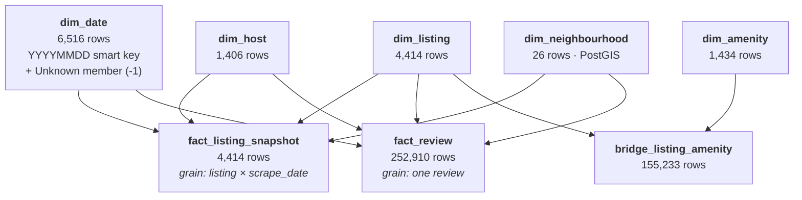

# Dimensional Model

Design rationale for the Gold layer: grain declarations, key strategy, dimension design, and the
decisions behind the less obvious modelling choices.

For column-level reference see [data_catalog.md](data_catalog.md). For layer architecture see
[data_architecture.md](data_architecture.md).

---

## 1. Design method

The model follows Kimball's four-step dimensional design process.

| Step | Outcome |
|---|---|
| **1. Select the business process** | Two processes are represented: the periodic observation of listing state (price, availability, ratings), and the guest review event. |
| **2. Declare the grain** | `fact_listing_snapshot`: one row per listing per scrape date. `fact_review`: one row per review. |
| **3. Identify the dimensions** | Listing, host, neighbourhood, date, amenity. |
| **4. Identify the facts** | Snapshot: price, availability, occupancy, estimated revenue, review scores. Review: comment length, with the review itself as the countable event. |

Grain is declared before dimensions and facts, and is enforced by assertions `G14`, `G15` and `G16`
rather than left as documentation.

---

## 2. Schema



This is a **fact constellation**: two fact tables sharing conformed dimensions, rather than a single
star. Listing, host, neighbourhood and date each mean the same thing in both facts, so a query can
compare review activity against listing economics along any shared dimension.

---

## 3. Conformed dimension matrix

| | dim_listing | dim_host | dim_neighbourhood | dim_date | dim_amenity |
|---|:---:|:---:|:---:|:---:|:---:|
| `fact_listing_snapshot` | ✔ | ✔ | ✔ | ✔ | via bridge |
| `fact_review` | ✔ | ✔ | ✔ | ✔ | — |

Host and neighbourhood are carried on `fact_review` by denormalisation rather than requiring a join
through `dim_listing`. This is a deliberate convenience for the common case of aggregating review
volume by neighbourhood or host, and is safe because a review's listing — and therefore its host and
neighbourhood — cannot change.

---

## 4. Fact tables

### 4.1 `fact_listing_snapshot`

**Grain:** one row per listing per scrape date.
**Type:** periodic snapshot.
**Rows:** 4,414.

The grain includes `scrape_date_key` even though the current extract yields exactly one row per
listing. Two reasons:

1. **The extract genuinely spans three capture dates** — 2026-06-15 (628 listings), 2026-06-16
   (2,904) and 2026-07-06 (846). Modelling the grain as listing-only would misrepresent data captured
   three weeks apart as simultaneous.
2. **Subsequent scrapes load without redesign.** A second extract inserts alongside the first. Had
   the grain been listing-only, the primary key would require restructuring.

**Measure classification:**

| Type | Measures | Aggregation |
|---|---|---|
| Additive | `number_of_reviews`, `number_of_reviews_ltm`, `number_of_reviews_l30d`, `estimated_revenue_l365d` | Summable across all dimensions |
| Semi-additive | `availability_30/60/90/365`, `availability_eoy`, `estimated_occupancy_l365d` | Summable across listings, **not across dates** — they describe a state at a point in time |
| Non-additive | `price_amount`, `reviews_per_month`, all seven `review_scores_*` | Average only; never sum |

Summing `price_amount` produces a meaningless figure. This distinction is the most common source of
error in querying snapshot facts.

**Degenerate provenance attributes.** `is_detail_sourced` and `is_freshly_scraped` are carried on the
fact as well as on `dim_listing`, so that provenance filtering requires no dimension join. This
duplication is intentional.

### 4.2 `fact_review`

**Grain:** one row per review.
**Type:** transaction fact.
**Rows:** 252,910, spanning 2009-03-21 → 2026-07-04 across 3,500 listings.

The fact is a countable event; `count(*)` is the primary measure. `comment_length` is an additive
measure serving as a proxy for review effort. `comments` carries the full review body — unusual for a
fact table, but this is the only location where the text exists, and it supports the downstream text
analysis listed as out of scope.

`reviewer_id` and `reviewer_name` are retained as degenerate dimensions rather than promoted to a
`dim_reviewer`. With 232,935 distinct reviewers and only a first name as an attribute, a dedicated
dimension would be nearly as large as the fact while carrying almost no analytical value.

**The join to `dim_listing` is an `INNER JOIN`, deliberately.** Because integration resolved every
orphan foreign key, the inner join drops no rows. Should a future extract reintroduce orphans, the
row count would fall and assertion `G07` would fail — the join is a structural regression test.

---

## 5. Dimensions

### 5.1 `dim_listing` — 4,414 rows

The integration point of the model. Built as a `LEFT JOIN` from the summary export onto the detailed
export, because the summary is the **row** superset (4,414 versus 4,378) while the detailed export is
the **column** superset (90 versus 19).

```sql
FROM      silver.summary_listings s
LEFT JOIN silver.detail_listings  d ON d.listing_id = s.listing_id
```

Attributes prefer the detailed source and fall back to the summary, which preserves the 36
summary-only listings with whatever attributes exist for them. `is_detail_sourced` marks those rows
so that consumers can distinguish sparse records from complete ones.

### 5.2 `dim_host` — 1,406 rows

Built with `DISTINCT ON (host_id)`, which is safe because the source contains **zero host attribute
conflicts**: no `host_id` is ever associated with two different names, tenures or superhost statuses.
This was verified before the dimension was designed, and removes any need for conflict-resolution
logic.

The view also unions hosts appearing only in the summary export. In the current extract this adds no
rows, because all 36 summary-only listings have a NULL `host_id`. The logic is retained because a
future extract may not share that property.

`is_multi_listing_host` is derived from `host_listings_count > 1` and supports market-concentration
analysis directly: 690 such hosts control 3,651 listings, or 83.7% of the market.

### 5.3 `dim_neighbourhood` — 26 rows

Carries a `geometry(MultiPolygon, 4326)` column alongside the name, with a GIST index on the Silver
table. `area_sqkm` is computed via `ST_Area(geom::geography)`, which returns true surface area rather
than degrees.

All four polygons repaired by `ST_MakeValid` are flagged with `geom_was_repaired`. Assertion `G29`
confirms that all 4,414 listings fall inside the boundary of their assigned neighbourhood, validating
both the coordinates and the repair.

`Harbor Islands` has no listings. It is retained as a legitimate dimension member with no
corresponding facts, not treated as an error.

### 5.4 `dim_amenity` — 1,434 rows

Derived from exploding the source JSON array. `listing_count` is precomputed so that amenity
frequency is available without traversing the bridge.

### 5.5 `dim_date` — 6,516 rows

Covers 2009-03-01 → 2026-12-31, bracketing the full review history.

**Key strategy.** `dim_date` uses an integer `YYYYMMDD` smart key rather than `ROW_NUMBER()`. This is
the conventional treatment: date keys stay stable across reloads, remain human-readable in a fact
table (`20260616` is self-evident), and permit range filtering on the key itself. It is the one
dimension where a meaningful key is preferable to a meaningless one.

---

## 6. Key strategy

| Key type | Pattern | Stability | Use |
|---|---|---|---|
| Surrogate | `<entity>_key` | **Not stable** — regenerated per query | Joins inside the warehouse |
| Natural | `<entity>_id` | Stable | Joins to external data; persisting results |

Surrogate keys are generated with `ROW_NUMBER() OVER (ORDER BY <natural key>)`, matching the
reference architecture. Because Gold consists of views, these are recomputed on every execution.

> **Consequence.** Never persist a `*_key` value outside the warehouse. A key extracted today may
> reference a different row after the next reload. Natural keys — `listing_id`, `host_id`,
> `review_id` — are stable and are retained on every dimension for exactly this purpose.

Materialising Gold would resolve this at the cost of a load procedure; see
[data_architecture.md](data_architecture.md) §8.3.

---

## 7. The unknown member

The 36 summary-only listings have price, availability and review counts, but **no scrape date** — the
summary export contains no `last_scraped` column. Since the fact grain includes `scrape_date_key`,
these rows require a key.

`dim_date` therefore carries a special member:

| `date_key` | `full_date` | `month_name` | `is_unknown_member` |
|---:|---|---|---|
| `-1` | NULL | `'Unknown'` | `true` |

This is standard Kimball practice and preferable to the alternatives:

| Approach | Assessment |
|---|---|
| **Unknown member (`-1`)** *(selected)* | Preserves all 4,414 listings with their measures; the absence is explicit and filterable |
| Exclude the 36 from the fact | Silently drops listings from every price and availability aggregate |
| Impute the maximum scrape date | Fabricates an unobserved fact, contradicting the project's "never impute" rule (D4) and becoming indistinguishable from real data |

Assertion `G24` confirms that exactly 36 rows carry `scrape_date_key = -1`.

---

## 8. The amenity bridge

A listing has many amenities and an amenity belongs to many listings — a many-to-many relationship
that cannot be represented in a dimension without either denormalising into repeated columns or
losing information.

`bridge_listing_amenity` resolves it at 155,233 rows, an average of 35.5 amenities per listing. Grain
is one row per listing-amenity pair, enforced by a composite primary key on the Silver table and
asserted by `G16`.

> **Fan-out.** Joining a fact through the bridge multiplies fact rows by the number of amenities on
> each listing. A `sum()` over such a join overcounts by approximately 35×.
>
> Safe: `avg()`, `count(DISTINCT listing_key)`, and aggregating the fact before bridging.
> Unsafe: `sum()` of any additive measure.

```sql
-- Correct: average price per amenity
SELECT da.amenity, round(avg(f.price_amount), 2)
FROM   gold.bridge_listing_amenity b
JOIN   gold.dim_amenity da          USING (amenity_key)
JOIN   gold.fact_listing_snapshot f USING (listing_key)
WHERE  f.is_freshly_scraped
GROUP  BY 1;

-- Incorrect: revenue is counted once per amenity, inflating the total ~35×
SELECT sum(f.estimated_revenue_l365d) FROM gold.bridge_listing_amenity b
JOIN gold.fact_listing_snapshot f USING (listing_key);
```

---

## 9. Slowly changing dimensions

All dimensions are **Type 1** — current state only, no history.

This is correct for the present extract because it represents a single point in time; there is no
prior state to preserve. Should multiple scrapes be loaded, `dim_listing` and `dim_host` would become
candidates for Type 2 treatment, since attributes such as `host_is_superhost`, `room_type` and
`license` genuinely change over time.

The snapshot fact already records measure history through its grain, so Type 2 dimensions would be
needed only to track *attribute* history, which is a separate concern.

---

## 10. Query patterns

### Recommended

```sql
-- Filter provenance, aggregate non-additive measures with avg()
SELECT dn.neighbourhood,
       count(*)                              AS listings,
       round(avg(f.price_amount), 2)         AS avg_price,
       round(avg(f.review_scores_rating), 3) AS avg_rating
FROM   gold.fact_listing_snapshot f
JOIN   gold.dim_neighbourhood dn USING (neighbourhood_key)
WHERE  f.is_freshly_scraped
GROUP  BY 1;
```

### Anti-patterns

| Pattern | Problem |
|---|---|
| `sum(price_amount)` | Non-additive measure; produces a meaningless total |
| `coalesce(review_scores_rating, 0)` | Converts "unrated" into "rated zero", depressing averages across 901 listings |
| Aggregating without `is_freshly_scraped` | Blends 846 stale listings averaging $146.89 with fresh ones averaging $370.77 |
| `sum()` through the bridge | Fan-out inflates additive measures roughly 35× |
| Persisting `listing_key` externally | Surrogate keys are regenerated on reload; use `listing_id` |
| Summing `availability_365` across dates | Semi-additive; valid across listings, not across time |
